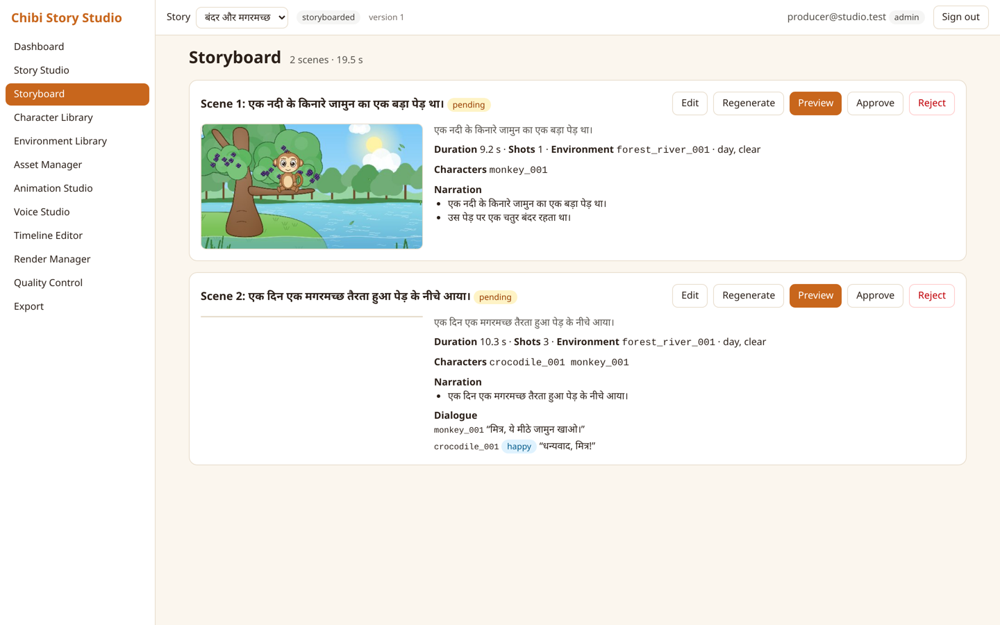

# Chibi Story Animation Engine

Turns a story into an animated 2.5D chibi film. Paste Hindi text; the engine analyses it, builds a storyboard from a
library of rigged characters, layered environments and animation clips, generates narration and voices, renders the
scenes with Blender and assembles a 1080p MP4 with FFmpeg. A story is only data: the same engine and assets have
produced four different stories without any story-specific code.

This folder is independent of the Tame app in the rest of the repository.



## What is here

| Path | Contents |
|---|---|
| `engine/` | the animation engine as a plain Python library (no web server, no database) |
| `backend/` | FastAPI + PostgreSQL service: users, versioned stories, asset mirror, render jobs |
| `frontend/` | the production dashboard (React, TypeScript, Tailwind) |
| `asset_library/` | 9 characters, 7 environments, 48 animation clips, props, effects, music, sound effects, voices |
| `stories/` | story texts and their Story Definitions |
| `renders/final/` | the finished films |
| `tools/asset_forge/` | draws the shipped art and synthesises the shipped audio |
| `tests/`, `frontend/e2e/` | automated tests, including real renders |
| `docs/` | documentation, screenshots and sample outputs |

## Quick start

```bash
bash scripts/setup_dev.sh && source .venv/bin/activate      # Ubuntu 24.04: packages, venv, PostgreSQL, migrations
python -m pytest -m "not render"                             # fast tests
python -m engine.cli render stories/panchatantra/lion_and_clever_rabbit.json --preview    # a film in a few minutes

CSAE_USER_PASSWORD='choose-a-long-one' python -m backend.cli create-user you@example.com --role admin
(cd frontend && npm ci && npm run build)
CSAE_FRONTEND_DIST=frontend/dist python -m backend.cli serve     # dashboard on http://127.0.0.1:8000
```

## A new story

1. Write the text with a blank line between scenes and spoken words in quotation marks.
2. `python -m engine.cli storyboard my_story.hi.txt --story-id my_story -o stories/original/my_story.json`
   The command lists any character, environment or prop the library does not have yet. Nothing is substituted.
3. `python -m engine.cli speech stories/original/my_story.json --retime`
4. `python -m engine.cli render stories/original/my_story.json --preview`, review, edit the JSON or use the dashboard,
   then render without `--preview`.

## Documents

[Status and phase reports](PROJECT_STATUS.md) · [Architecture](docs/ARCHITECTURE.md) ·
[Story schema](docs/STORY_SCHEMA.md) · [Asset format](docs/ASSET_FORMAT_SPEC.md) ·
[Animation schema](docs/ANIMATION_SCHEMA.md) · [Rendering](docs/RENDERING_GUIDE.md) · [API](docs/API_DOCUMENTATION.md) ·
[Testing](docs/TESTING_GUIDE.md) · [Deployment](docs/DEPLOYMENT_GUIDE.md) · [Set-up](docs/DEVELOPMENT_SETUP.md) ·
[Audit](docs/PROJECT_AUDIT.md) · [Dependencies](docs/DEPENDENCY_REPORT.md) · [Plan](docs/IMPLEMENTATION_PLAN.md) ·
[Changelog](CHANGELOG.md)

## Known limits

- The art is drawn procedurally (vector shapes) and the default voice is espeak-ng, because no image generator or
  neural voice service was reachable while this was built. Both are ordinary library assets and provider adapters:
  hand-painted layers or a Sarvam AI voice replace them without code changes. All shipped designs are marked
  `pending`: approving them is a human decision.
- Characters have one view (front for bipeds, side for the crocodile); turning is a horizontal flip.
- The rule-based analyser understands Hindi and basic English and the vocabulary in `engine/story_intelligence/lexicon.py`.
  Other languages or freer prose need the LLM analyser, which was tested only against a fake provider (no key here).
